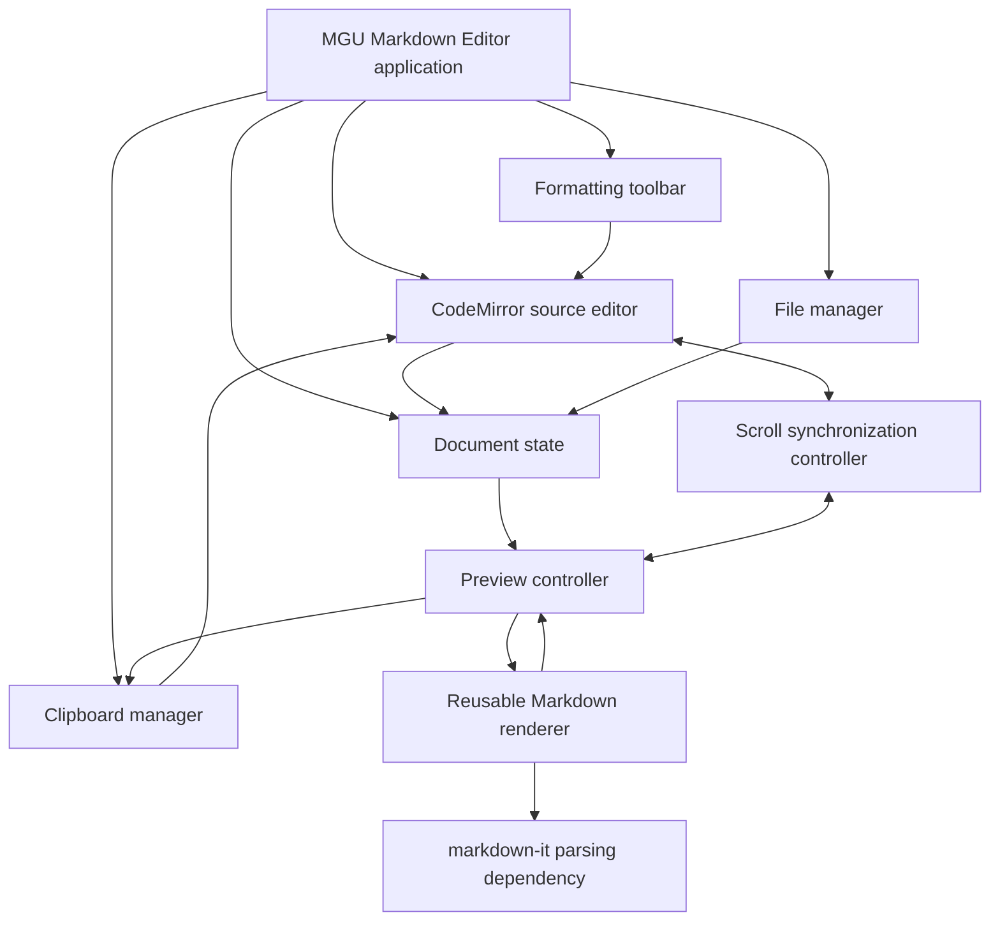

# MGU Markdown Editor and Rendering Engine — v0.2.0
## Engineering Specification Sheet

| Document field | Specification |
|---|---|
| Issuing institution | Malone Global University (MGU) |
| Product family | MGU Developer Tools Suite |
| Product | MGU Markdown Editor and Rendering Engine |
| Document classification | Software Engineering Specification |
| Target application version | v0.2.0 |
| Specification revision | 0.1 |
| Document date | November 27, 2026 |
| Development status | Proposed requirements; implementation and verification pending |
| Predecessor | v0.1.0 — accepted development baseline; external archival not yet confirmed |
| Governing architecture | WA-008 — MGU Reusable Software Module Architecture |
| Parent specification | `mgu-markdown-editor-engineering-specification.md` |

## 1. Purpose and scope

Upgrade the functional v0.1.0 Markdown workspace into a practical browser-based document authoring application. The upgrade shall provide professional source editing, formatting controls, local file operations, clipboard operations, live and manual rendering, and optional bidirectional synchronized scrolling.

The primary operational use case is creating and revising long-form MGU documents, particularly Encyclopedia articles and software engineering documentation. The original Markdown source shall remain authoritative; the preview is a read-only derived representation.

The rendering engine shall remain application-independent in accordance with WA-008. This release may extend the renderer with optional source-position metadata needed for synchronized scrolling, but shall not duplicate parsing logic or introduce the editor's UI dependencies into the renderer.

### 1.1 Baseline evidence

The v0.1.0 release has owner-confirmed browser operation, real-world article rendering, successful basic formatting and security smoke tests, and six passing automated renderer tests. The owner confirmed panel resizing, reset, independent scrolling, undo/redo and Render Now. The prior release documentation identifies browser-based oversized-input recovery, exact statistics and browser console checks as nonblocking unverified items. These shall be included in v0.2.0 regression verification.

The existing `renderMarkdown(source, { inertLinks })` interface returns an HTML fragment and diagnostics. The current preview uses a sandboxed iframe with an empty sandbox permission list and a restrictive content security policy. The renderer enforces a 200,000 UTF-16 code-unit rendering limit. These facts govern the compatibility and security design of the upgrade.

## 2. System architecture

### 2.1 Component responsibilities

| Proposed module | Responsibility |
|---|---|
| `editor.mjs` | CodeMirror integration, application orchestration, selection and editing transactions, keyboard interaction, statistics. |
| `toolbar.mjs` | Selection-aware Markdown formatting and editing commands. |
| `file-manager.mjs` | Browser file selection, UTF-8 decoding and encoding, saving, Save As and download fallbacks. |
| `document-state.mjs` | Filename, current source, last successfully saved source, dirty state and active file handle where supported. |
| `clipboard.mjs` | Source selection, full-source copying, rendered preview copying, cut and paste with capability and permission checks. |
| `preview.mjs` | Render scheduling, isolated presentation, diagnostics, rendered revision and scroll-position restoration. |
| `scroll-sync.mjs` | Bidirectional source-to-preview position mapping, scroll synchronization controls and feedback-loop prevention. |
| `renderer.mjs` | Pure Markdown parsing, HTML generation, diagnostics and optional source-line mapping. No UI, clipboard or filesystem dependencies. |

Module names are proposed implementation boundaries. Shared functions shall be kept separable from application-specific DOM bindings where practical. Formal standalone packaging remains scheduled for v0.4.0.

### 2.2 Data flow and state ownership

1. The editor creates or modifies the authoritative Markdown source through editing transactions.
2. Document state tracks the current source, filename and last successfully saved snapshot; selection and scroll changes do not mark the document dirty.
3. The preview controller requests rendering of the current source when permitted by the live/manual mode.
4. The renderer returns HTML and diagnostics, with optional source-position metadata if requested.
5. The preview controller records the revision actually displayed; scroll synchronization uses that revision's valid mapping only.
6. The file manager saves the authoritative source, never the generated preview. Clipboard commands explicitly distinguish source from rendered content.

## 3. User interface specification

The interface shall preserve the v0.1.0 split-pane concept and existing MGU Developer Tools visual identity. Controls shall be logically grouped and keyboard accessible.

| Interface region | Required controls and indicators |
|---|---|
| File toolbar | New, Open, Save, Save As, Download. |
| Editing toolbar | Undo, Redo, Cut, Copy, Paste, Find, Replace. |
| Formatting toolbar | Heading selection (levels 1–6), Bold, Italic, Bold and Italic, Unordered List, Ordered List, Blockquote, Inline Code, Link, Horizontal Rule. |
| Preview controls | Live Preview On/Off, Sync Scroll On/Off, Render Now. |
| Workspace controls | Editor width slider, Reset to 50/50. |
| Source panel | CodeMirror editor, Markdown syntax highlighting, line numbers, active line, Copy Source. |
| Preview panel | Read-only rendered document, Copy Preview, explicit stale/error status when applicable. |
| Document and status indicators | Filename, unsaved changes, encoding, line and column, line/word/code-unit counts, renderer version, preview and synchronization status. |

Proposed defaults: live preview enabled; synchronized scrolling enabled when a valid mapping is available; equal-width panels; UTF-8 source. Independent scrolling shall remain available. The defaults may be adjusted during design verification without removing any required control.

## 4. Functional requirements

| ID | Requirement |
|---|---|
| FR-201 | Replace the native textarea with CodeMirror 6 while preserving authoritative source editing and undo/redo. |
| FR-202 | Provide Markdown-aware syntax highlighting using a compatible language extension. |
| FR-203 | Display line numbers, active-line highlighting, and current cursor line and column. |
| FR-204 | Provide selection-aware formatting commands for the supported Markdown constructs listed in Section 5. |
| FR-205 | Provide New, Open, Save and Save As operations, with direct file access where supported and safe fallbacks elsewhere. |
| FR-206 | Provide a browser Download operation for the current Markdown source. |
| FR-207 | Protect unsaved changes before replacing a document or leaving the application; maintain an accurate dirty indicator. |
| FR-208 | Provide Find and Replace, including Replace All through the editing component. |
| FR-209 | Retain standard editing shortcuts and introduce nonconflicting file and formatting shortcuts. |
| FR-210 | Provide a Live Preview On/Off toggle; Render Now shall work in either mode. |
| FR-211 | Provide explicit Cut, Copy and Paste source editing controls. |
| FR-212 | Provide Copy Source for the entire current Markdown document without modifying it. |
| FR-213 | Provide Copy Preview as formatted content where supported, with a plain-text fallback. |
| FR-214 | Provide bidirectional synchronized scrolling between the source and the rendered document. |
| FR-215 | Provide a Sync Scroll On/Off toggle; disabling it shall restore independent panel scrolling. |
| FR-216 | Preserve preview position during automatic rendering where possible; manual Render Now retains the verified top-of-document refresh behavior. |
| FR-217 | Retain the adjustable panel-width controls and 50/50 Reset behavior. |

## 5. Editor and formatting behavior

### 5.1 Editing

CodeMirror 6 shall provide native text selection, undo/redo history, indentation support, line wrapping or a usable horizontal-scroll alternative, and search. Reuse compatible existing MGU CodeMirror dependencies; identify missing language or search packages before installation. Formatting, cut, paste and replace operations shall use editor transactions so they participate in undo history.

### 5.2 Formatting commands

| Command | Source result / behavior |
|---|---|
| Heading 1–6 | Apply the selected number of `#` markers to the current or selected lines. |
| Bold | Wrap selection with `**` delimiters. |
| Italic | Wrap selection with `*` delimiters. |
| Bold and Italic | Wrap selection with `***` delimiters. |
| Unordered List | Prefix selected nonblank lines with `- `. |
| Ordered List | Prefix selected nonblank lines with sequential numeric markers. |
| Blockquote | Prefix selected lines with `> `. |
| Inline Code | Wrap selection with suitable backtick delimiters. |
| Link | Insert `[label](URL)` syntax; allow editing of the destination. |
| Horizontal Rule | Insert a standalone `---` with appropriate surrounding line breaks. |

Commands shall operate on selected text or insert editable placeholders at the cursor when there is no selection. Multi-line operations shall avoid corrupting unrelated lines. Focus shall return to the source editor after a toolbar action. Unsupported extended Markdown features shall not be advertised as rendered capabilities in this version.

### 5.3 Keyboard shortcuts

Retain Ctrl+Z, Ctrl+Y (and compatible redo alternatives), Ctrl+X, Ctrl+C, Ctrl+V, and Ctrl+F in the editing context. Proposed file shortcuts are Ctrl+S and Ctrl+Shift+S for Save and Save As. Formatting shortcuts may include Ctrl+B and Ctrl+I where they do not conflict with required editor behavior. Browser-reserved shortcuts may not be interceptable; visible controls remain the primary fallback.

## 6. File operations and document state

| Operation | Required behavior |
|---|---|
| New | Create an empty document with a default filename, proposed `untitled.md`, after resolving unsaved changes. |
| Open | Select a local Markdown file, decode its source and establish a new clean document baseline only after a successful read. |
| Save | Write the current source to the existing authorized file handle when available; otherwise request a destination or use an explicitly identified download fallback. |
| Save As | Request a new destination/name and retain the new handle only after a successful write. |
| Download | Generate a Markdown source download with an appropriate filename and UTF-8 encoding. |

Use the File System Access API when available in a supported secure browser context, with ordinary file input and Blob-based download alternatives. Do not require a server-side write endpoint. Browser downloads cannot establish that a particular existing local file was overwritten; the status must distinguish a successful write from a download request. Do not clear dirty state merely because a download was initiated without confirmation of the intended save outcome.

The application shall preserve Unicode and meaningful whitespace. Define and test a line-ending and UTF-8 BOM policy; byte-for-byte preservation of all encodings is not implied. Unsupported or unreadable files shall produce a clear error without replacing current content. File picker cancellation and denied permissions shall not destroy the current source or its saved baseline. If editing continues during an asynchronous write, dirty state shall reflect the actual saved snapshot rather than blindly marking newer edits saved.

For New and Open with unsaved changes, provide a Save/Discard/Cancel decision or equivalent safe workflow. A canceled or failed save shall not authorize discarding content. Register a browser-native leave warning only when dirty; browsers may restrict or suppress it. No automatic recovery or persistent document library is required until v0.5.0.

## 7. Clipboard operations

| Control | Required behavior |
|---|---|
| Cut | Copy the selected Markdown source and remove it only after a successful clipboard write; no selection means no destructive action. |
| Copy | Copy the selected Markdown source without modification. |
| Paste | Insert clipboard plain text at the cursor or replace the active selection as one undoable editing operation. |
| Copy Source | Copy the complete authoritative Markdown document regardless of selection. |
| Copy Preview | Copy the most recently successfully rendered visible document, preferably as `text/html` plus `text/plain`, with a plain-text fallback. |

Programmatic clipboard access shall occur in response to user actions, respect browser permissions and report failures accurately. Native keyboard clipboard operations shall remain available if the asynchronous Clipboard API is unavailable or denied. Do not silently substitute full-document copy for a selection-only command. Paste shall insert text as Markdown source, not execute clipboard HTML or scripts. Copy Preview shall exclude the preview shell, diagnostic messages, synchronization markers and application controls; rich output shall retain only safe document content, including inert links. When the preview is stale, explicitly indicate that Copy Preview copies the displayed revision, not unrendered edits; disable it when no valid rendered document exists.

## 8. Rendering and synchronized scrolling

### 8.1 Preview modes

| Mode | Behavior |
|---|---|
| Live preview enabled | Debounce source changes (existing 180 ms delay is the initial reference), render the latest revision, and preserve the reading position where possible. |
| Live preview disabled | Keep the last rendered document visible and mark it stale after source changes; do not automatically render. |
| Render Now | Cancel any pending automatic render and render the latest source immediately. Reset preview to the top; if synchronization is active and valid, align the source to the corresponding top position without feedback oscillation. |

Enabling live preview shall refresh stale content. Superseded render/load callbacks shall not replace newer state. Empty source shall show an appropriate empty state. Oversized input or a rendering failure shall produce a diagnostic and preserve source editing and file operations. Recovery shall occur after valid input is restored and rendering is requested or scheduled.

### 8.2 Synchronization design

The preferred technique is source-line mapping using parser token ranges and rendered block positions. The renderer may expose optional mapping metadata or emit controlled source-line attributes for preview mode, without changing default fragment output. The scroll controller shall map the leading visible source line to a corresponding rendered block, interpolate between mapped blocks when appropriate, and perform the inverse mapping for preview-driven scrolling.

- Support source-to-preview and preview-to-source movement, including long paragraphs, nested lists, variable heading sizes and code blocks supported by the baseline.
- Match document starts and ends, and maintain a usable correspondence in the middle. Exact pixel-level equivalence is not required because source and rendered layouts differ.
- Suppress programmatically induced reciprocal scroll events; coalesce rapid scroll updates and recalculate positions after preview loads, panel resizing and layout changes.
- Suspend synchronization against stale or failed preview revisions; resume after a successful current render. Turning synchronization off shall immediately restore independent scrolling.
- A proportional-scroll fallback may be used if source mappings are unavailable, but must be clearly identified as approximate and must not be represented as section-accurate synchronization.

### 8.3 Preview isolation and security constraint

The v0.1.0 iframe uses `sandbox=""`, which gives the preview an opaque origin. Direct parent access to its document and scroll position is therefore blocked. Bidirectional synchronization and rich preview copying require an explicit design decision rather than simply adding cross-frame DOM access.

A proposed option is an iframe retaining sandbox restrictions but allowing same-origin access for the trusted parent (`allow-same-origin` only), while continuing to prohibit scripts, forms, popups and top-level navigation and keeping the restrictive CSP. This relaxes the opaque-origin boundary and shall be reviewed and regression-tested before adoption. Never combine `allow-scripts` and `allow-same-origin` for this untrusted-content preview. An alternative isolation design is permissible if it demonstrably meets both synchronization and security requirements.

Raw HTML execution, external image loading and active preview links shall remain prohibited. Only trusted application code shall access preview DOM state. Generated mapping attributes must be derived from validated numeric parser positions, not raw source HTML. Do not relax renderer validation or preview CSP merely to obtain clipboard or scrolling functionality. A security regression blocks release acceptance.

## 9. Architectural and nonfunctional requirements

| ID | Requirement |
|---|---|
| AR-201 | Preserve WA-008 separation: rendering, editing, file management, clipboard and synchronization responsibilities shall have explicit boundaries. |
| AR-202 | Retain backward compatibility with the v0.1.0 rendering interface and default HTML fragment behavior; any optional metadata extension shall be documented. |
| AR-203 | Identify application and renderer versions separately. A renderer interface change shall receive a documented module version. |
| AR-204 | Preserve the completed HTML editor and v0.1.0 application; develop v0.2.0 in a new versioned directory. |
| NFR-201 | Maintain source integrity during rendering, formatting, clipboard operations and file failures. |
| NFR-202 | Retain the current 200,000 UTF-16 code-unit render threshold unless a separately approved and verified change is made. |
| NFR-203 | Maintain responsive editing and scrolling for the representative approximately 7,600-word MGU article; measure render and interaction behavior during local testing without claiming an unverified latency guarantee. |
| NFR-204 | Preserve raw HTML, unsafe protocol, external resource and navigation protections; no untrusted script execution in the preview. |
| NFR-205 | Provide accessible control labels, visible focus, usable keyboard navigation and status feedback not dependent on color alone. |
| NFR-206 | Reuse compatible root npm dependencies, record actual installed versions and lockfile, and produce a reproducible local browser bundle without runtime CDN dependencies. |
| NFR-207 | Retain document statistics, defining counts consistently; test empty, multiline and Unicode inputs. |
| NFR-208 | Record supported browser capabilities and fallbacks; initial acceptance environment is the owner's Windows/Chrome localhost workflow. |

## 10. Verification and acceptance criteria

| Test ID | Coverage | Minimum passing result |
|---|---|---|
| AT-201 | FR-201–203, FR-208–209 | Syntax highlighting, line numbers, cursor status, find/replace, undo/redo and supported shortcuts work in the browser. |
| AT-202 | FR-204 | Each formatting command produces correct Markdown with and without a selection; undo restores prior source. |
| AT-203 | FR-205–207 | New/open/save/save-as/download work as supported; an actual saved file reopens with equivalent source including Unicode, multiline text and whitespace under the documented encoding policy. |
| AT-204 | FR-207 | Dirty-state, canceled picker, denied access, failed write, asynchronous save and discard protection behave correctly without data loss. |
| AT-205 | FR-211–212 | Cut/copy/paste and full-source copy work; permission denial is handled; failed cut does not remove text; paste and cut can be undone. |
| AT-206 | FR-213 | Copy Preview yields readable rendered text; verify rich HTML in a compatible destination when supported; no app controls, mapping markers or unsafe active content are copied. Stale and failed previews behave as specified. |
| AT-207 | FR-210, FR-216 | Live toggle stops automatic updates; manual render updates immediately; re-enabling live refreshes stale content; automatic rendering preserves reading position; manual reset does not create conflicting scroll behavior. |
| AT-208 | FR-214–215 | On a long document, source-driven and preview-driven scrolling align corresponding sections at the beginning, middle and end without oscillation. Turning sync off restores independent scrolling. |
| AT-209 | FR-214–217 | Resize/reset, rapid scrolling, new documents and preview refreshes recalculate mappings safely. Stale or failed render suspends synchronization; recovery restores it. |
| AT-210 | AR-202, NFR-204 | All six original automated renderer tests pass unchanged, plus new tests for mapping and preview isolation. Browser smoke tests confirm inert links, raw HTML, unsafe protocols and external resource blocking. |
| AT-211 | NFR-201–203, NFR-207 | Real MGU article, empty/malformed Markdown and oversized input render or fail gracefully; source is retained, stats are correct under documented definitions, and removing oversized input restores preview. |
| AT-212 | NFR-205–208 | Verify keyboard access, readable normal/narrow layouts, absence of uncaught application console errors, documented browser fallbacks and successful root-based test/build execution. |

Automated tests shall cover reusable logic wherever feasible, particularly formatting transformations, document-state transitions, clipboard failure behavior, scroll mapping and renderer regression. Browser-dependent operations shall be manually exercised or tested through an appropriate browser test harness. Report actual results as passed, failed, not applicable or not verified; do not infer a browser pass from a Node-only test. Mandatory requirements must pass in the intended environment; unsupported browser-specific capabilities may pass through their documented fallback. Data loss, unsafe execution, broken core file/clipboard workflows and unusable required scrolling controls are release blockers.

## 11. Release implementation and preservation

1. Confirm the v0.1.0 external backup and preserve its accepted source and generated runtime unchanged.
2. Create the v0.2.0 project directory and inventory existing root dependencies before changes.
3. Integrate CodeMirror and implement editing, formatting and document-state modules.
4. Implement file and clipboard operations, then preview mode controls and synchronization.
5. Run baseline and new automated tests, generate the local browser bundle and execute browser acceptance tests.
6. Resolve blocking defects; document approved deferrals, limitations and the actual test evidence.
7. Freeze the verified version; preserve the complete versioned project, generated bundle, tests, README, technical design, root npm manifests and lockfile on external backup storage outside `C:\MGU`.
8. Document the milestone in MGU Software Development Records and verify deployment if published. Proceed to v0.3.0 only after acceptance and archival.

Proposed implementation destination (following the currently operating versioned app location):

`C:\MGU\library\reference\software-documentation\mgu-licensed-software\mgu-markdown-editor-v0.2.0\`

This location describes the application workspace, not the institutional filing destination for this specification. File the engineering specification in the MGU Software Repo under the Markdown Editor project; the exact repository path remains unconfirmed.

## 12. Roadmap boundaries and open engineering decisions

| Version | Development objective |
|---|---|
| v0.1.0 | Functional editor and rendering engine — accepted; archival confirmation pending. |
| v0.2.0 | Professional source editing, formatting, file management, clipboard operations and synchronized preview navigation. |
| v0.3.0 | Tables, fenced code blocks, mathematical notation and extended Markdown. |
| v0.4.0 | Independently consumable renderer distribution and MGU publication styling. |
| v0.5.0 | Persistent document management, recovery and advanced rendered export. |
| v1.0.0 | Verified, documented and stable production release. |

Do not include tables, mathematical rendering, fenced-code rendering, persistent document storage, rendered-file export or integration into the completed HTML editor as mandatory v0.2.0 deliverables. Syntax highlighting may recognize syntax that the current preview intentionally does not render. Clipboard copying of rendered content is in scope; advanced rendered-file export is not.

Open engineering decisions include exact CodeMirror dependency versions, preview isolation implementation, mapping granularity and fallback, browser compatibility matrix, encoding/line-ending policy, and final shortcut bindings. The proposed defaults and module names are design guidance, not claims of implemented capabilities. Version assignments remain provisional.

## 13. Engineering disposition

**Proposed for implementation — v0.2.0.** The release shall deliver a usable Markdown authoring environment while preserving the independently tested rendering foundation. The editor is the application; the renderer is reusable infrastructure. File handling, clipboard operations and synchronized scrolling should likewise be structured for future reuse without forcing consuming applications to adopt the complete Markdown Editor interface.
