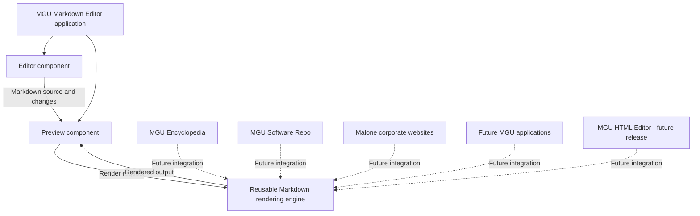

# MGU Markdown Editor and Rendering Engine
## Engineering Specification Sheet

| Document field | Specification |
|---|---|
| Issuing institution | Malone Global University (MGU) |
| Product family | MGU Developer Tools Suite |
| Project | MGU Markdown Editor and Rendering Engine |
| Document revision | 0.1 — proposed specification |
| Target production release | v1.0.0 |
| Development status | Proposed; implementation not yet verified |
| Architecture reference | WA-008 — MGU Reusable Software Module Architecture |
| Document classification | Software engineering specification |

## 1. Purpose and scope

Develop a browser-based Markdown authoring application with a live document preview and a reusable Markdown rendering engine. The project shall deliver one integrated development initiative with two independently bounded software deliverables: the editor application and the rendering module. The module shall be designed for reuse by other MGU applications and publishing systems without requiring the editor interface.

The initial scope includes Markdown authoring, rendering, formatting, file operations, extended Markdown, publication styling, document persistence and export. Integration into other applications is a subsequent implementation activity; it is not a condition for the editor's initial functional milestone.

## 2. System architecture



| Component | Architectural layer | Responsibilities |
|---|---|---|
| Editor component | Application | Text editing, syntax highlighting, formatting controls, source document state and file management. |
| Preview component | Application | Request rendering when source changes; present the rendered document using the selected display style; report rendering failures without losing source text. |
| MGU Markdown Renderer | Reusable infrastructure | Parse Markdown, process supported extensions and return rendered output through a documented interface. Must not depend on editor UI state or controls. |
| Publication styling | Presentation | Apply MGU-compatible document styling without embedding institutional navigation or application-specific layout in the parser. |

### 2.1 Data flow

1. The user creates, imports or modifies a Markdown document in the editor.
2. The editor maintains the original Markdown source as the authoritative document state.
3. The preview component submits source and supported options to the rendering engine.
4. The renderer returns output and, where applicable, diagnostics.
5. The preview component displays the output. File saving and export remain application responsibilities.

### 2.2 Module interface

A conceptual interface is proposed below; the exact language, types, packaging and synchronous or asynchronous execution model remain subject to implementation design.

```ts
renderMarkdown(source: string, options?: RenderOptions): RenderResult
```

The result should expose rendered HTML and any available rendering diagnostics. The renderer shall be callable independently of the editor, and consumers shall not be required to import the editor UI, document storage or file-management code. Presentation styling shall be separable from parsing and rendering.

## 3. Functional requirements

| ID | Requirement | Target milestone |
|---|---|---|
| FR-001 | Create and edit Markdown source in a browser-based interface. | v0.1.0 |
| FR-002 | Render supported basic Markdown and update the preview as source changes. | v0.1.0 |
| FR-003 | Provide formatting controls and Markdown-aware syntax highlighting. | v0.2.0 |
| FR-004 | Import and export Markdown files while preserving source content. | v0.2.0 |
| FR-005 | Support tables, mathematical notation, fenced code blocks and selected extended Markdown features. | v0.3.0 |
| FR-006 | Expose the rendering engine as an independently consumable, documented module. | v0.4.0 |
| FR-007 | Support MGU-compatible publication styling independently of the parser. | v0.4.0 |
| FR-008 | Provide document management, local persistence and rendered document export. | v0.5.0 |
| FR-009 | Complete functional, regression and integration verification; preserve and document the stable release. | v1.0.0 |

Markdown file export in FR-004 refers to saving source text; FR-008 refers to additional export of rendered content. Specific additional export formats and persistence behavior are not yet approved.

## 4. Architectural and nonfunctional requirements

| ID | Requirement |
|---|---|
| AR-001 | Maintain explicit separation between the editor application, preview presentation and reusable rendering engine from the initial implementation. |
| AR-002 | Maintain a single authoritative rendering implementation; consuming applications shall not duplicate parsing logic. |
| AR-003 | Use a documented rendering interface and independently identifiable module versions. |
| AR-004 | Preserve existing stable application releases; integrations shall occur in new, separately verified versions. |
| NFR-001 | Treat Markdown source as authoritative; rendering errors shall not overwrite or destroy source text. |
| NFR-002 | Keep interactive preview responsive under representative document loads; define measurable performance thresholds during implementation. |
| NFR-003 | Prevent unsafe execution of untrusted Markdown or embedded HTML in preview and publication contexts through an appropriate sanitization and isolation policy. |
| NFR-004 | Keep rendering output deterministic for equivalent input, options and dependency versions. |
| NFR-005 | Provide reproducible dependency installation, documented build/run procedures and a versioned regression test corpus. |
| NFR-006 | Maintain usable keyboard navigation, readable preview output and clear error feedback. |
| NFR-007 | Preserve a verified versioned baseline at each successful milestone on external backup storage outside the active repository, with applicable manifests, lockfiles and a README. |

## 5. Intended reuse and deployment

| Consumer | Intended use | Integration status |
|---|---|---|
| MGU Markdown Editor | Native live Markdown preview and rendering. | Initial consumer |
| MGU Encyclopedia | Render Markdown articles for publication. | Proposed |
| MGU Software Repo | Render software documentation and engineering records. | Proposed |
| Malone corporate websites | Render Markdown-based corporate content and working documents. | Proposed |
| Future MGU applications | Import rendering functionality as a shared module. | Proposed |
| MGU HTML Editor | Add Markdown authoring and preview in a future version through the shared engine and a Markdown editing mode. | Proposed; archived release unchanged |

The renderer alone does not add editing capabilities to the HTML editor. The consuming application must also implement the language mode, file handling and preview routing needed for Markdown. Each consumer shall verify its own integration and security context before deployment.

## 6. Proposed development milestones

| Release | Development objective | Minimum acceptance evidence |
|---|---|---|
| v0.1.0 | Functional Markdown editor with live preview. | Basic headings, paragraphs, emphasis, lists and links render correctly; changing source updates the preview; rendering logic is isolated behind a component or module boundary. |
| v0.2.0 | Formatting toolbar, syntax highlighting and file operations. | Formatting operations work on source text; Markdown files can be opened and saved; source round-trip tests pass. |
| v0.3.0 | Tables, mathematical notation, code blocks and extended Markdown. | Supported syntax is documented and representative fixtures render correctly, including malformed input handling. |
| v0.4.0 | Reusable rendering module and MGU publication styling. | An independent test consumer invokes the renderer without editor UI dependencies; publication styles are demonstrated separately; interface and versioning are documented. |
| v0.5.0 | Document management, persistence and export capabilities. | Documents can be restored after reload under documented storage conditions; supported exports are verified; data-loss and storage-failure behavior is tested. |
| v1.0.0 | Verified, documented and stable production release. | Approved functional and regression tests pass; release documentation, dependency records and external backup are complete; production deployment is verified where applicable. |

Version assignments are provisional engineering milestones, not formal release commitments. The renderer separation begins at v0.1.0; v0.4.0 is the proposed milestone for formal packaging, independent consumption and publication styling, not the first point at which modularity is introduced.

## 7. Revised development portfolio roadmap

| Project | Reported or proposed status |
|---|---|
| MGU HTML Editor | Complete — archived, backed up and documented |
| MGU Markdown Editor and Rendering Engine | Proposed |
| MGU Advanced Code Editor | Earlier milestones completed |
| MGU Integrated Development Environment | Planned |
| MGU Website Management Utilities | Proposed |
| MaloneOS | Research and planning |
| Malone Bank Ledger System | Research and planning |

This table records the supplied development portfolio position; it does not authorize schedules, budgets or the initiation of unrelated projects.

## 8. Verification and release controls

Each milestone shall be assessed against its defined scope before development advances. At minimum, verification shall include representative Markdown fixtures, preview/source consistency, source-file round trips, malformed input, unsafe-content handling and regression checks for completed capabilities, as applicable to the milestone. The module shall also be tested without the application UI before it is released for independent consumption.

Following successful verification, freeze the milestone, preserve a versioned external backup and document the verified capabilities, dependencies, build/run instructions, known limitations and next milestone. Failed acceptance criteria shall be recorded and resolved or explicitly deferred before release approval. Integration into existing applications shall use a new application version and shall not modify the archived HTML editor baseline.

## 9. Open engineering decisions

The following decisions remain open pending implementation planning and technical evaluation:

- Editor technology, rendering library or parser strategy, and module distribution format.
- Supported Markdown dialect, extension list and mathematical notation renderer.
- Sanitization policy, handling of raw HTML and preview isolation model.
- File operations, storage model, supported rendered export formats and document recovery behavior.
- Performance targets, supported browsers, accessibility criteria and deployment environment.
- Final repository layout, public module naming, licensing and dependency policies.

No particular library, framework, storage mechanism or deployment platform is mandated by this preliminary specification.

## 10. Engineering disposition

**Proposed for development.** The editor is the application; the renderer is reusable infrastructure. Both shall be developed within one coordinated project, with separate responsibilities, testable boundaries and controlled versioning. Future integrations shall consume the verified module rather than reproduce its functionality.

Recommended filing: MGU Software Repo, within the Markdown Editor and Rendering Engine project documentation. WA-008 remains the platform-level architectural reference in MGU Public Records / Website Architecture. The exact Software Repo path and project identifier have not yet been confirmed.
